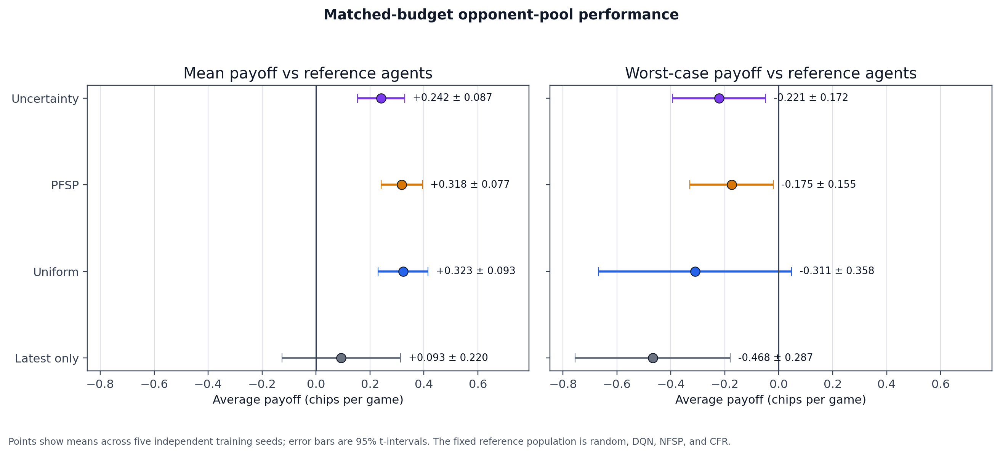
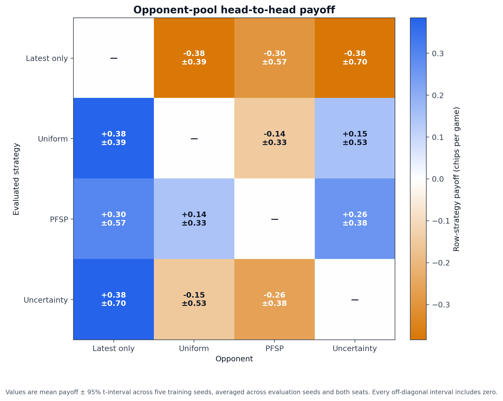
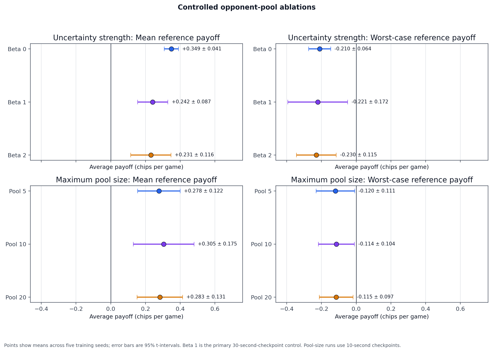
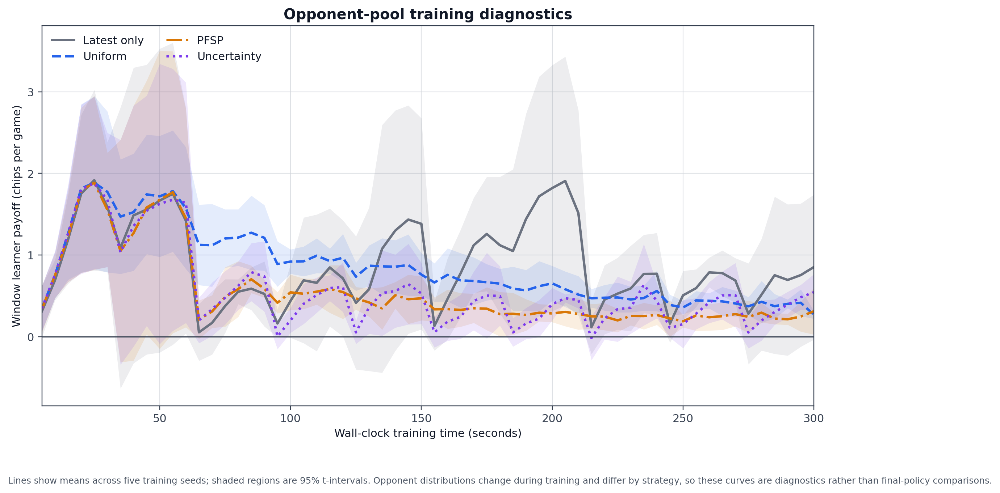

# Experimental Results

## Matched-Budget Baseline Experiment

The primary experiment compares DQN, NFSP, CFR, and random play in two-player Leduc Hold'em.

DQN and NFSP were trained through self-play. CFR was trained through regret minimization. Random play required no training and was used only during evaluation.

### Experimental Design

Each trained algorithm received:

- 300 seconds of CPU training time per run
- Five independent training seeds: 1, 2, 3, 4, and 5
- The same software environment and hardware
- Model checkpoints recorded from clean Git commit `fe53387`

Each matchup used:

- Five evaluation seeds: 11, 22, 33, 44, and 55
- 2,000 games from each player position
- 20,000 games per training seed
- 100,000 games per matchup
- 600,000 games across all six matchups

Payoff is measured in average chips won per game by the first listed agent. Positive values favor the first agent, while negative values favor its opponent.

For each training seed, results were averaged across evaluation seeds and player positions. The reported 95% confidence intervals were then calculated across the five independently trained models using Student's t distribution.

## Training Budget

The algorithms received equal wall-clock budgets, although their natural training units differ.

| Algorithm | Training unit | Mean completed units | Range |
|---|---|---:|---:|
| DQN | Self-play episodes | 87,239 | 85,951–89,036 |
| NFSP | Self-play episodes | 50,348 | 49,164–51,701 |
| CFR | CFR iterations | 48,515 | 48,155–48,888 |

Episode counts and CFR iterations should not be compared directly. The controlled resource was 300 seconds of training time.

## Matched-Budget Results

| First agent | Opponent | Mean payoff | 95% CI |
|---|---|---:|---:|
| DQN | Random | +0.8839 | ±0.0436 |
| NFSP | Random | +0.5176 | ±0.0144 |
| CFR | Random | +0.7530 | ±0.0445 |
| DQN | NFSP | +0.4726 | ±0.0573 |
| DQN | CFR | -0.0683 | ±0.0704 |
| NFSP | CFR | -0.4474 | ±0.0506 |

## Interpretation

All three trained methods consistently beat random play. DQN extracted the most payoff from the random opponent, followed by CFR and NFSP.

DQN clearly defeated NFSP. Its 95% confidence interval against NFSP remains entirely above zero.

CFR also clearly defeated NFSP. NFSP's payoff against CFR was negative for all five independently trained model pairs.

CFR had a small average advantage over DQN. DQN scored `-0.0683 ± 0.0704` against CFR, but this interval includes zero. The experiment therefore does not establish a statistically reliable winner between DQN and CFR.

The results show that performance against random play and head-to-head strength measure different behavior. DQN exploited random actions most effectively, while CFR remained competitive against DQN and strongly defeated NFSP.

## Reproducibility Files

- `results/matched_baseline_training_manifest.csv` records every training run, completed unit count, elapsed time, and artifact directory.
- `results/matched_baseline_raw.csv` contains all 150 training-seed and evaluation-seed observations.
- `results/matched_baseline_summary.csv` contains the six final matchup estimates and confidence intervals.
- Training checkpoints and generated artifacts are excluded from Git because they can be recreated through the documented commands.

## Matched-Budget Opponent-Pool Experiment

This experiment compares four historical self-play strategies using the same DQN architecture and training implementation:

1. Latest-only checkpoint selection
2. Uniform historical checkpoint sampling
3. Standard PFSP
4. Uncertainty-aware PFSP

### Experimental Design

Every strategy received:

- Five independent training seeds: 1, 2, 3, 4, and 5
- 300 seconds of wall-clock training per seed
- A checkpoint interval of 30 seconds
- A maximum pool size of 10
- 100 evaluation games per historical opponent
- Opponent evaluation and selection overhead included in the training budget
- Training code from Git commit `5a93418`

The complete study contains 20 training runs. Every run completed successfully and saved 10 checkpoints.

| Strategy | Mean episodes | Episode range |
|---|---:|---:|
| Latest | 143,997 | 129,299–167,560 |
| Uniform | 152,779 | 130,844–212,974 |
| PFSP | 148,060 | 134,742–191,341 |
| Uncertainty | 147,776 | 138,330–172,903 |

The controlled resource was wall-clock time. Episode counts are reported to expose differences in training throughput.

Each final policy was evaluated:

- Against random, DQN, NFSP, and CFR reference agents
- Against each of the other opponent-pool strategies
- Across five evaluation seeds: 11, 22, 33, 44, and 55
- From both player positions
- With 2,000 games per player position
- Using matched training seeds for trained opponents

The evaluation contains 22 matchup types, 550 training-seed and evaluation-seed observations, and 2.2 million games.

### Aggregate Reference Results

Reference mean payoff averages performance against random, DQN, NFSP, and CFR. Worst-case payoff first selects the weakest reference result within each training seed and then calculates the mean and confidence interval across training seeds.

| Strategy | Mean reference payoff | Worst-case reference payoff |
|---|---:|---:|
| Latest | +0.0935 ± 0.2197 | -0.4676 ± 0.2873 |
| Uniform | **+0.3226 ± 0.0929** | -0.3108 ± 0.3583 |
| PFSP | +0.3180 ± 0.0766 | **-0.1749 ± 0.1551** |
| Uncertainty | +0.2417 ± 0.0874 | -0.2212 ± 0.1723 |

Uniform sampling produced the highest mean payoff against the fixed reference population. PFSP produced the strongest worst-case point estimate.

### Head-to-Head Results

Payoff is reported for the first listed strategy.

| First strategy | Opponent | Mean payoff | 95% CI |
|---|---|---:|---:|
| Latest | Uniform | -0.3796 | ±0.3918 |
| Latest | PFSP | -0.2965 | ±0.5694 |
| Latest | Uncertainty | -0.3844 | ±0.7042 |
| Uniform | PFSP | -0.1448 | ±0.3349 |
| Uniform | Uncertainty | +0.1507 | ±0.5333 |
| PFSP | Uncertainty | +0.2608 | ±0.3769 |

Every head-to-head interval includes zero. The evaluation therefore does not establish a reliable direct winner in any pairwise matchup.

### Paired Comparisons

Paired comparisons first average evaluation seeds within each training seed. Differences are then calculated between strategies using the same training seed, and the 95% confidence interval is calculated across the five paired differences.

Uniform had a higher mean reference payoff than latest:

```text
latest minus uniform = -0.2291 ± 0.1984
```

Uniform also had a higher mean reference payoff than uncertainty:

```text
uniform minus uncertainty = +0.0809 ± 0.0640
```

Both intervals exclude zero.

The proposed uncertainty method did not improve over PFSP:

```text
Mean reference payoff:
uncertainty minus PFSP = -0.0763 ± 0.1457

Worst-case reference payoff:
uncertainty minus PFSP = -0.0463 ± 0.2135
```

Both uncertainty-versus-PFSP intervals include zero, and both point estimates favor PFSP.

All paired worst-case comparisons between the four strategies include zero.

### Hypothesis Evaluation

- **H1 was not established.** Historical sampling produced better worst-case point estimates than latest-only training, but the paired confidence intervals include zero.
- **H2 was not established.** PFSP had a better worst-case point estimate than uniform sampling, but the paired difference was inconclusive.
- **H3 was not supported.** The uncertainty-aware method did not improve mean or worst-case payoff over standard PFSP.
- **H4 is evaluated separately below.** The primary experiment tested only the default uncertainty strength and pool size; the controlled ablation section reports the follow-up configurations.

### Interpretation

The default uncertainty-aware configuration did not outperform the simpler alternatives. Under this budget, uniform sampling had the strongest average reference performance, while standard PFSP had the strongest worst-case point estimate.

This is a negative result for the proposed default method rather than evidence that uncertainty-aware selection can never help. The controlled ablations below test additional uncertainty strengths and pool sizes under the same training budget; they likewise do not establish a statistically clear winner.

These reference and head-to-head measurements are not exact exploitability estimates.

### Reproducibility Files

- `results/pool_training_manifest.csv` records all 20 training runs.
- `results/pool_benchmark_raw.csv` contains all 550 benchmark observations.
- `results/pool_benchmark_summary.csv` contains the 22 matchup summaries.
- `results/pool_benchmark_aggregate.csv` contains mean and worst-case reference metrics.
- `results/pool_benchmark_paired.csv` contains all 12 paired strategy comparisons.
- Evaluation code was published in Git commit `cd9a755`.

## Controlled Ablation Experiment

The exploratory ablation study tests whether uncertainty strength, historical-pool size, or historical-opponent selection changes performance under the same 300-second training budget.

### Experimental Design

The study trained five new configurations across training seeds 1–5:

| Configuration | Family | Key setting | Checkpoint interval | Final pool size |
|---|---|---|---:|---:|
| Beta 0 | Uncertainty strength | `beta=0` | 30 seconds | 10 |
| Beta 2 | Uncertainty strength | `beta=2` | 30 seconds | 10 |
| Pool 5 | Pool size | Maximum size 5 | 10 seconds | 5 |
| Pool 10 | Pool size | Maximum size 10 | 10 seconds | 10 |
| Pool 20 | Pool size | Maximum size 20 | 10 seconds | 20 |

The primary uncertainty run supplies the `beta=1` control. The primary latest-only run supplies the comparison without historical-opponent selection. Both controls used the same training seeds and 300-second budget.

The complete ablation training contains 25 new runs:

| Configuration | Mean episodes | Episode range | Checkpoints per run |
|---|---:|---:|---:|
| Beta 0 | 137,594 | 104,295–182,707 | 10 |
| Beta 2 | 144,287 | 113,674–180,165 | 10 |
| Pool 5 | 139,545 | 105,887–160,057 | 30 |
| Pool 10 | 142,749 | 118,127–155,939 | 30 |
| Pool 20 | 137,785 | 112,122–156,413 | 30 |

Each final policy was evaluated against random, DQN, NFSP, and CFR using five evaluation seeds, 2,000 games from each player position, and matched training seeds. The evaluation contains 500 observations and 2,000,000 games.

### Aggregate Reference Results

| Configuration | Mean reference payoff | Worst-case reference payoff |
|---|---:|---:|
| Beta 0 | +0.3490 ± 0.0411 | -0.2104 ± 0.0635 |
| Beta 1 | +0.2417 ± 0.0874 | -0.2212 ± 0.1723 |
| Beta 2 | +0.2311 ± 0.1161 | -0.2295 ± 0.1149 |
| Pool 5 | +0.2777 ± 0.1224 | -0.1196 ± 0.1110 |
| Pool 10 | +0.3051 ± 0.1747 | -0.1138 ± 0.1038 |
| Pool 20 | +0.2830 ± 0.1309 | -0.1154 ± 0.0972 |

Beta 0 produced the highest mean-reference point estimate in the uncertainty-strength family. Pool 10 produced the highest mean and worst-case point estimates in the pool-size family. Point estimates alone do not establish that either configuration is better.

### Paired Comparisons

For each comparison, evaluation seeds were averaged within each training seed. Differences were calculated between configurations using the same training seed, and 95% confidence intervals were calculated across the five paired differences.

| Family | Difference | Mean-reference difference | Worst-case difference |
|---|---|---:|---:|
| Uncertainty strength | Beta 0 minus Beta 1 | +0.1073 ± 0.1169 | +0.0108 ± 0.1621 |
| Uncertainty strength | Beta 0 minus Beta 2 | +0.1179 ± 0.1353 | +0.0191 ± 0.1001 |
| Uncertainty strength | Beta 1 minus Beta 2 | +0.0106 ± 0.1385 | +0.0083 ± 0.1026 |
| Pool size | Pool 5 minus Pool 10 | -0.0274 ± 0.0636 | -0.0057 ± 0.1273 |
| Pool size | Pool 5 minus Pool 20 | -0.0053 ± 0.2359 | -0.0042 ± 0.1997 |
| Pool size | Pool 10 minus Pool 20 | +0.0221 ± 0.2849 | +0.0016 ± 0.1713 |
| Historical selection | Latest minus Beta 1 | -0.1482 ± 0.2177 | -0.2464 ± 0.3739 |

All 14 confidence intervals include zero. The experiment therefore does not establish a reliable difference for uncertainty strength, pool size, or latest-only versus default uncertainty-aware training.

### Interpretation

The uncertainty bonus did not produce a measurable improvement under the tested conditions. Beta 0 had the strongest mean-reference point estimate, but its paired advantages over Beta 1 and Beta 2 were inconclusive.

Pool sizes 5, 10, and 20 performed similarly. Their paired mean and worst-case differences were small relative to their uncertainty, so this experiment does not support a preferred pool size.

Latest-only training had weaker mean and worst-case point estimates than the default uncertainty configuration, but both paired comparisons remained inconclusive.

**H4 was tested but not supported.** Changing uncertainty strength and pool size did not yield a statistically clear improvement. These are exploratory comparisons across five training seeds and should not be interpreted as proof that the hyperparameters never matter.

The reference metrics are robustness measurements against a fixed opponent population. They are not exact exploitability measurements.

### Reproducibility Files

- `results/ablation_training_manifest.csv` records all 25 ablation training runs.
- `results/ablation_benchmark_raw.csv` contains all 500 evaluation observations.
- `results/ablation_benchmark_summary.csv` contains 20 reference-matchup summaries.
- `results/ablation_benchmark_aggregate.csv` contains 10 aggregate metrics.
- `results/ablation_benchmark_paired.csv` contains all 14 paired comparisons.
- Training code was published in Git commit `005dc61`.
- Evaluation code was published in Git commit `bc49b61`.

## Research Figures

### Primary Robustness Metrics



Uniform sampling had the highest mean-reference point estimate, while PFSP had the strongest worst-case point estimate. The paired analysis is required for significance; separate interval overlap alone does not determine whether two strategies differ.

### Primary Head-to-Head Matrix



Positive values favor the row strategy. Every off-diagonal 95% interval includes zero, so the direct matchups do not establish a reliable winner.

### Controlled Ablations



Beta 0 produced the highest mean-reference point estimate in the uncertainty-strength family. Pool sizes 5, 10, and 20 produced similar results. All paired ablation intervals include zero.

### Training Diagnostics



The curves show learner payoff against the opponents sampled during training. The sampled opponent population changes over time and differs across strategies, so the curves cannot substitute for fixed-policy evaluation. They show that latest-only training was especially variable, while uniform sampling maintained a steadier payoff later in training.

### Mechanism Hypotheses

The results support several explanations worth testing, but they do not establish causality:

- Uniform sampling may reduce overfitting to recent checkpoints by maintaining broad historical exposure. This is consistent with its strong mean-reference result.
- PFSP may improve weak matchups by concentrating training on opponents that cause losses. This is consistent with its strongest worst-case point estimate.
- The uncertainty bonus may spend part of the fixed budget revisiting less-evaluated opponents rather than the opponents causing the largest current losses. Because opponent evaluation counts toward the training budget, this could reduce useful training experience.
- Latest-only training faces a rapidly changing opponent and may cycle between narrow responses. Its variable diagnostic curve and weaker robustness point estimates are consistent with that possibility.

These explanations remain hypotheses. Distinguishing them would require targeted measurements such as opponent-selection entropy, forgetting against older checkpoints, training-time decomposition, and additional independent seeds.

## Earlier Exploratory Results

Earlier experiments evaluated one saved checkpoint per algorithm under unequal training procedures. Those results helped validate the environment and evaluation code but should not be used as the primary comparison between algorithms.

The earlier fixed-checkpoint data remains available in:

- `results/baseline_evaluation.csv`
- `results/cfr_evaluation.csv`
- `results/baseline_summary.png`
- `results/head_to_head_matrix.png`

## Limitations

The experiment uses simplified Leduc Hold'em rather than full Texas Hold'em.

Five training seeds provide an initial estimate of training variability, but additional seeds would produce narrower and more stable confidence intervals.

Wall-clock budgets depend on hardware and background system load. The manifest records completed training units so results can be compared with later replications.

The experiment tests one 300-second training budget. It does not show how the algorithms compare with shorter or longer training.

Exploitability has not yet been measured. Head-to-head payoff and performance against random opponents do not prove that an agent approximates a Nash equilibrium.
